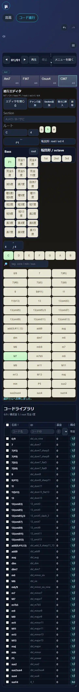

# UI実画面監査 — 2026-10-26（調査・修正前の基準画像）

対象：公開GitHub Pages `https://kinoko34077.github.io/Micro-Chordbot/`、PC版Chromeのheadless Chromium/Chromeモバイルviewportエミュレーション。スマホ実機Safariではない。**この監査は原因究明と設計優先順位の基準であり、実装完了やユーザビリティ合格を示さない。**

## 証拠画像

| ケース | 証拠 |
| --- | --- |
| 幅390px、進行エディタ展開、PWA案内閉じ | [画像](./mobile-progression-expanded.webp) |
| 幅390px、進行エディタ折りたたみ、PWA案内閉じ | [画像](./mobile-progression-collapsed.webp) |
| 幅390px、**音高画面を選んだ状態**、PWA案内閉じ | [画像](./mobile-pitch-incorrect-secondary-view.webp) |
| 幅667px・高さ375px、横画面相当、PWA案内あり | [画像](./landscape-667.webp) |
| 幅1280px・高さ800px、デスクトップ3ペイン、PWA案内あり | [画像](./desktop-1280.webp) |

## 実測（390×844px、PWAバナーを閉じて進行エディタを展開）

| セクション | ページ上端からの座標/サイズ |
| --- | --- |
| 共通ヘッダー | y=0, h=248px |
| 進行ビュー開始 | y=256px |
| 進行セルのグリッド | y=343px, h=79px |
| 選択された進行エディタ | y=428px, h=1535px |
| 詳細編集領域本体 | y=541px, h=1414px |
| ルート音選択ボタン群 | y=1228px, h=42px |
| コード種選択ボタン群 | y=1315px, h=627px |
| コードライブラリ | y=1976px, h=1381px |
| 文書の全高 | 3382px |

実測値はChrome DevTools device metrics `390×844`、`deviceScaleFactor=1`で`getBoundingClientRect`により取得。実機Safariでは表示差があり得る。

## Finding（観測事実 → 影響仮説 → 受入条件）

### F1 / P0：表示対象の混線

**観測：** 「音高」タブ選択時にもコード進行コントロールとコードライブラリが下方へ表示される（`mobile-pitch-incorrect-secondary-view.webp`、`#view-progression`の表示領域 `y=1578`）。JS上の`body.dataset.currentView`は`pitch`。CSS `@media(max-width:640px)`内に` .view#view-progression { display:block; }` があり、`.view { display:none; }`の非選択状態規則を上書きする可能性が高い。**コード根拠とブラウザ実測が一致した原因候補**。タブが機能しているように見えて、違う機能が下部へ混入する。解決時は非選択ビューがDOM上で表示されないことを実ブラウザでテストする。

### F2 / P1：画面の「編集」が実際の主操作へ届かない

**観測：** スマホで選択済みコードのエディタはy=428から存在するが、ルート音候補はy=1228、コード種候補はy=1315に始まる。Bass/転回形を含む高度な選択肢が前方に常時広く置かれる。**影響：**コード進行の頻回編集に画面1〜2枚以上のスクロールが必要。**受入：**コードセルを選んだ直後、ルート、コード種、長さを同じ近接文脈で少ない操作数で調整可能。Bass/転回形などの機能は残し、必要時に容易に呼べる。

### F3 / P1：ナビゲーション/履歴群の過大占有

**観測：** 幅390pxで共通ヘッダーが248px。画面高さ844pxに対して29.4%を占有。全主要タスクを下方向へ圧迫する。**受入：**スマホ用の独立した情報階層で、ビュー切替、Undo/Redo、主要音量等の導線を保持しつつ、編集対象の表示領域を増やす。単純な文字縮小や操作隠蔽に依存しない。

### F4 / P1：参照ライブラリの長大テーブル

**観測：** コードライブラリだけで1381px、編集エディタの直下で同一縦スクロールを長く占有。幅390pxではID/構成情報のテーブルが横スクロール・切り取りを伴う。**受入：**編集中のコードと参照・再利用するコードの関連が分かり、検索・選択・比較を短い動線で行える。詳細表は必要時に残せるが、全件表を主要編集領域の既定表示の中心としない。

### F5 / P1：狭いボタンで文字が断片化

**観測：** チャンク追加、Section追加、後ろに挿入、削除などが幅390pxの一列へ詰められ、文字が不自然に改行・分割。**受入：**操作意味を認識できるラベルと十分なタップ領域を確保し、頻度と危険度で配置を決定する。削除を主操作群へ等重みで置かない。

### F6 / P1：横画面・PCも単純に成功と見なせない

**観測：** 幅667・高さ375では進行ツールバーが高さ189pxを占め、進行エディタ開始はy=409px（初期viewport外）。幅1280の3ペインでは進行エディタ内部スクロールがあり、コード候補群が下方で切れる。**受入：**選択対象と頻回編集を同時に扱える。単なるdocument横はみ出しゼロでは不十分。

## 設計・修正順序（草案、実装未着手）

1. **P0 表示状態修正**：非選択ビューの非表示を`[hidden]`または`.active`を唯一の責務とする。同等の条件を再発防止テストにする。
2. **P1 モバイル主操作の再配置**：コード一覧→選択中コード→ルート/コード種/拍数を近傍に配置。Bass/転回形/詳細は操作可能な開閉領域に移す。ユーザーの進行グリッド列数1〜12はそのまま保持。
3. **P1 共通ナビゲーションとライブラリ分離**：スマホ専用のコンパクト配置、参照ライブラリは検索・呼び出し主体。Undo/Redoと作業状態を保持。
4. **P1 PCの3ペインにおける視認性**：ペインごとに主要操作と参照情報を再配置し、不要な内部スクロールやフォーカス外の可読性低下を減らす。
5. **検証**：320/390/430/667/844/1280のスクリーンショット、選択・編集・閉じる・戻す操作を対象に、表示到達性・ビュー排他・保存互換・Undo/Redo・列数・iOS実機差分を記録する。

**制約：** 既存Chordbotの外観のコピーはしない。KiNoTch.のUI/UX正本およびRepository UI_UX_POLICYに従い、主機能を削除せず、直接操作と選択状態を維持。Site Kitの未検証APIを無条件に組み込まない。

## 参照と区分

- 正本：リポジトリ`AGENTS.md`、`guidelines/UI_UX_POLICY.md`、Issue #28、および共有Google Drive`03_Development_Specification_Principles.md`、`利用者起点 UI-UX 設計原則.md(1).txt`。
- **実測**：上記画面画像/DOM幾何。**原因仮説**：優先順位や構造が縦スクロールと操作負担を生む。**未検証**：実際のiOS Safari実機の見た目、具体的なユーザー所要時間、最終的な新配置。
